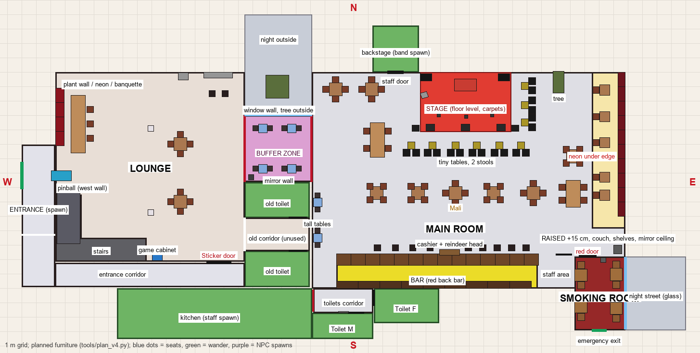

# Plan v4 — the venue from the real floor map (2026-11-01, 🏗️ venue-rebuild)

Source: `docs/art/direction/08-floor-map-real.png` (route `17`, photos 09–22, legend and answers in
`docs/art/direction/README.md`). Data of record for this plan: `game/tools/plan_v4.py` (rooms, doors, planned
furniture), rendered by `python game/tools/plan_view.py docs/art/screens/plan/plan-v4.png --planned`.
Geometry of record once built: `game/tools/build_venue.gd` → `game/assets/kit/layout.json`.

## Scale and axes

- The map file is 1500 × 771 px; regions were segmented by colour (lounge/main beige, green rooms, pink buffer, red
  stage, yellow bar, dark-red couch and smoking room, grey stairs and corridors, blue/gold/black furniture).
- Main room on the map: 655 px wide (x 808–1463) × 453 px deep (y 188–641, stage wall to the wall behind the bar).
- **One scale on both axes, anchored on the depth: 15 m = 453 px → 1 px = 0.0331 m.** That makes the main room
  **21.7 × 15 m**, not 30 × 15. Reason: Daniele's figure is rough and the map's own proportion is 1.45 : 1; stretching
  only the x axis to 30 m would make the smoking room (3.5 × 5.1 m here, long and narrow as in photo 13) and the buffer
  zone (4.6 × 4.6 m, photos 14/15) wide and square, and give a 19 m bar. If Daniele confirms 30 m along the bar wall,
  change `S` in `plan_v4.py` to an (sx, sz) pair and re-run; everything else derives from the map.
- Axes as in `plan_view.py`: x east, z south (north is -z, up on the sheet), y up. x = 0 at the lobby's west (street)
  wall; z = 0 at the shared north wall of lounge and main room. Room height 4 m (DECISIONS 2026-10-27 j).

## Rooms (walkable), metres (x0, z0) – (x1, z1)

| Room | x | z | Notes |
|---|---|---|---|
| Entrance lobby (spawn) | 0.0–2.3 | 5.05–14.9 | Street door on the west wall z 6.25–8.1 (spawn in front of it, leave through it). Open threshold at z 11.3 into the corridor part. Dim. |
| Entrance corridor | 2.3–15.45 | 13.25–14.9 | Along the south of the lounge, 1.65 m wide, dead-ends east. Dim (photos later). |
| Sticker door | 12.8–14.5 | 13.15 | Lounge south wall → corridor. Open all night. |
| Lounge | 2.35–15.45 | 0.0–13.15 | Columns at (8.95, 3.9) and (8.95, 9.75). Stairs: flight up the west wall x 2.35–4.15, z 8.5–11.5 (rising south) onto a solid block x 2.35–8.65, z 11.5–13.15. |
| Old corridor (unused) | 15.45–19.95 | 10.1–12.4 | Alcove off the lounge's east wall; closed doors at both ends into the old toilets. Walkable, empty, dim. |
| Buffer zone | 15.45–20.1 | 3.0–7.6 | Curtains (open) at x 15.45 and x 20.1 over the full z 3.0–7.6. North wall = window (night outside, bare tree at (17.7, 1.0), faint streetlight). South wall = mirror panels. Four tall tables. |
| Main room | 20.1–41.8 | 0.0–15.0 | South wall at z 15.0 behind the bar (x 21.8–35.75), at z 12.65 east of x 35.75 (staff area, smoke door). West wall x 20.1 except the buffer opening. |
| Raised strip | 39.5–41.8 | 0.0–10.85 | +0.15 m, ramp collider along its west edge (navmesh climbs it), neon strip under the edge, couch x 41.3–41.8 along the east wall, shelves above, mirror ceiling panels. South-east corner (z 10.85–12.65) at floor level. |
| Toilet corridor / vestibule | 20.1–21.8 → 20.2–24.35 | 7.6–15.0 → 15.0–16.7 | The strip west of the bar runs south from the buffer opening into the vestibule; kitchen curtain on its west wall (x 20.2, z 15.1–16.6), Toilet F door east (x 24.35, z 15.1–16.2), Toilet M door south (z 16.7, x 22.6–23.7). Picture light + framed picture, vinyl on the wall. |
| Smoking room | 38.3–41.8 | 12.8–17.9 | Red door from the main room (z 12.65–12.8, x 38.6–39.8); emergency exit south (z 17.9, x 39.5–40.5); glass wall east (x 41.8) to a night street; black ceiling, dark west wall with pictures, air purifier by the door. |

Never walkable (green): backstage x 24.3–27.5, z −3.2–0 (band spawn; staff door x 25.35–26.45 in the north wall);
kitchen x 6.6–20.1, z 15.0–18.5 (staff spawn, behind the curtain); Toilet F x 24.4–28.9, z 15–17.4; Toilet M
x 20.1–24.35, z 16.7–18.5; old toilets x 15.45–19.95, z 7.65–10.1 and z 12.4–14.9; walled bar staff area x 35.75–38.25,
z 12.65–15.0 (staff spawn; staff door x 37.0–38.1). They are built as closed doors with a dark box behind.

## Furniture (centres in metres; chairs per table as on the map)

| Where | What |
|---|---|
| Lounge | Current furniture kept on the **west wall**: plant wall + neon over a banquette x 2.35–2.95, z 1.1–5.1, long table at (3.9, 3.6) N–S with three chairs east of it. **Pinball on the west wall** at (2.75, 7.2) facing east. **Game cabinet** (`game_cabinet_bc`) at (9.4, 12.7) against the south wall, by the stairs, near the Sticker door. CRT (11.2, 0.3), collectibles shelf (13.6, 0.22) with the high counter and two stools on the north wall. Two round tables with four chairs at (11.0, 5.0) and (11.0, 9.0) so the room is not empty (the real lounge changes often). |
| Buffer zone | Tall square tables at (16.7, 3.9), (18.7, 3.9), (16.7, 6.7), (18.7, 6.7), two tall stools each (east/west); the lane z 4.4–6.2 stays clear for the route. PAR on a stand in the SW corner (15.9, 7.3). |
| West opening | Tall tables at (20.5, 9.05) and (20.5, 11.5), stools north/south; 0.95 m passage east of them to the toilets. |
| West of the stage | Four-chair tables at (21.75, 1.2) (map: square) and (24.25, 1.2) (circle); rectangular table 2.4 × 1.0 m at (24.65, 4.7) N–S (scaled `communal_table`), two chairs a side. |
| Stage | Floor level, x 27.6–33.9, z 0–4.15, 6 × 4 carpet tiles. Drums (30.75, 0.9), amp stacks (28.0, 0.35) / (33.4, 0.35), guitar on stand (27.9, 1.6), mics z 3.0–3.1 at x 28.9 / 30.8 / 32.6, wedges z 3.85, PA at the front corners. Curtains + slatted backdrop centre on the north wall behind; truss with four PARs. Band spots: drums (30.75, 0.5), guitar (28.9, 2.2), vocal (30.8, 2.4), bass (32.6, 2.2). |
| Tiny tables | Six at z 5.1, x 27.0 / 28.45 / 30.05 / 31.55 / 33.1 / 34.6, two drum stools each on the south side. Three at x 34.85, z 0.95 / 2.3 / 3.5, stools east of them facing the stage. |
| Tree | Bare tree right of the stage at (37.2, 0.7), between stage and raised strip (photo 19). |
| Row of five | Table0 (24.6, 8.4) ◇, Table1 (27.45, 8.4) ◇, **Table2 (30.05, 8.4) ○ = Mali's**, Table3 (32.7, 8.4) ◇, Table4 (35.45, 8.4) ○; four chairs each, diamonds get the chairs at 45°. |
| East | Four-chair table (38.2, 5.85) ◇; rectangle 1.9 × 1.0 m at (38.2, 8.45) N–S. |
| Raised strip | Five round tables (scale 0.8) at x 40.4, z 1.25 / 3.1 / 4.9 / 7.3 / 8.55; one chair west of each, two couch seats east. Couch tiles `couch_long` x 41.55 the whole length; `shelf_wall_tile` at 1.6 m and 2.1 m on the east wall; mirror ceiling panels at 3.95 m over x 39.5–41.8. |
| Bar | Counter 14 × `bar_counter` x 21.8–35.8 at z 13.0 (0.65 deep), cashier bump `cashier_counter` (29.65, 12.5) 1.4 × 0.4 m, nine back-bar bays x 22.55 + 1.5 i at z 14.75 (bay 4 = `back_bar_art`), **reindeer head** on the back wall over the cashier (29.65, 2.3, 14.9). Counter stools at z 12.2: x 24.65 / 25.9 / 27.1 / 28.3 (west four) and 30.95 / 31.95 / 32.95 / 33.95 / 34.95 (east five, as drawn). Bartender spot (29.65, 13.9). Wine fridge (41.3, 12.3) and the Black Cabin light box over the smoke door (photo 12). |
| Smoking room | Square tables 0.85 m at (41.2, 14.05), (38.75, 14.1), (38.75, 16.3), (41.2, 16.4), wishbone chairs north and south of each (the 1.6 m middle lane stays clear), ashtray on each; air purifier (40.3, 13.05); framed pictures and a picture light on the west wall; three window panels on the east wall. |

## Zones (runtime, from layout.json)

- Interaction zones (`venue_zones.gd`): **bar** from the `bar_counter` run (trigger 3.4 m deep in front of it — the
  floor in front is open now, so the counter strip is reachable); **stage** from the `stage_carpet_tile` bounds (no
  platform any more) + 2 m front row; **table** for every `round_table` of zone Tables (Table0–4, EastTable,
  WestTable0–1, Raised0–4; Mali at **Table2**); **arcade** at the pinball (`pinball_machine`, or `arcade_cabinet` while
  the kit lacks it) on the lounge's west wall; **exit** at `exit_sign` ExitSignStreet on the lobby's west wall
  (approach east of the door). New stubs that open the generic table sheet: **cabinet** (game_cabinet_bc), **tall**
  (every tall table), **smoking** (the smoking room, one zone, approach inside the red door).
- Camera zones (`camera_rig.gd`): lobby, corridor, lounge, buffer, stub (with lounge), floor (main room, fallback),
  stage (x 26.5–36, z 0–6.5), bar (x 21.8–35.75, z 9.5–15), toilets (vestibule + strip), smoking. HUD names in
  `strings_venue.csv` (`venue.zone.*`, EN+TH) for the new ones.
- Spawns: player in the lobby at (1.2, 7.2) facing east; NPC spawn markers (pose `spawn`, exported as `NPC_SPAWN`)
  backstage (25.9, −1.5), kitchen (18.5, 16.5), staff area (37.0, 13.8); seats by zone Lounge / Buffer / Tables /
  Bar / Smoking (patrons: at least one per zone, then random up to `seated_count`).

## Lighting budget (≤ 42, counted by `build_venue.gd`)

| Area | Lights |
|---|---|
| Key (shadowed directional, as iteration 18) | 1 |
| Lobby + corridor (dim warm, one each) | 2 |
| Lounge: neon, two red panels, long table, pinball glow | 5 |
| Buffer: PAR on stand (red spot), streetlight outside the window | 2 |
| Stage: four truss PAR spots | 4 |
| Tiny tables / west tables / row of five / east (shared warm omnis, candles emissive) | 2 + 1 + 3 + 1 |
| Raised strip: two warm pools, two neon-red under-edge omnis | 4 |
| Bar: three red back-bar omnis, two counter pools, one over the cashier/reindeer | 6 |
| SE corner light box | 1 |
| Toilet corridor picture light | 1 |
| Smoking room (two warm, plus the street glow is emissive) | 2 |
| Disco ball glint | 1 |
| **Total** | **36** |

Draw calls and GPU ms for the floor view are reported by `capture_venue.gd` after the build (budget: no worse than
iteration 18's ~1,850 calls / 24 ms).

## Navigation

Navmesh (baked in `build_venue.gd`, cell 0.1 / 0.05, agent radius 0.4, climb 0.05) over: lobby, corridor, lounge
(around the stairs block and columns), old-corridor alcove, buffer, main room, raised strip (via a 0.6 m ramp collider
along the west edge and the south end), the strip to the vestibule, the smoking room (through the red door opening).
Closed rooms get no floor. Route check: spawn → corridor → Sticker door → lounge east → buffer → main → bar →
smoking room is one connected mesh (smoke_tap goals updated to this route).

## Open points for Daniele (not blocking)

1. 30 × 15 m vs the map's 21.7 × 15 m (see Scale). 2. East counter-stool group: the map shows five, the brief says four;
built as drawn. 3. The old corridor alcove: walkable and empty, or roped off. 4. Which wall of the smoking room has the
glass: built east (street side, photos 20/21), emergency exit south.
