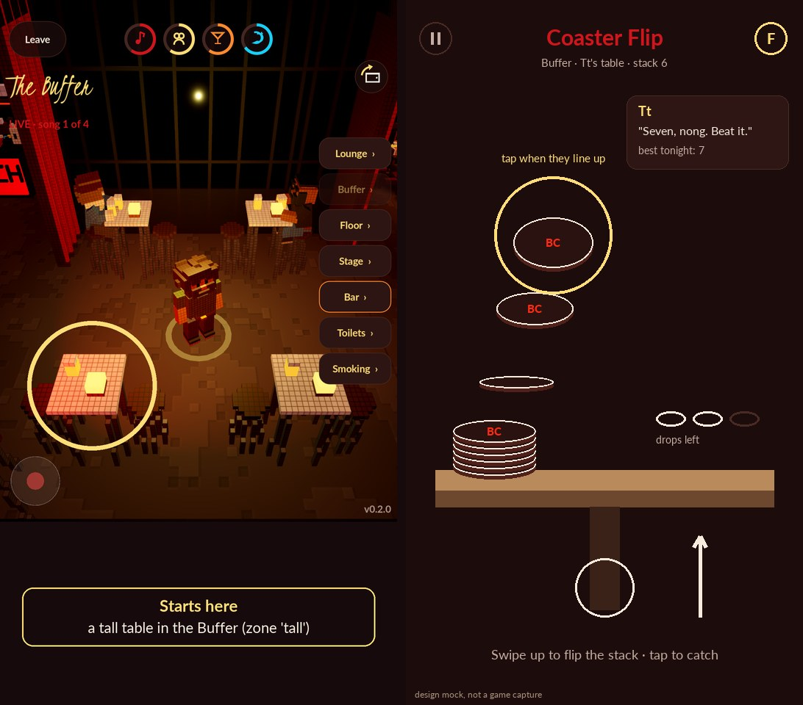
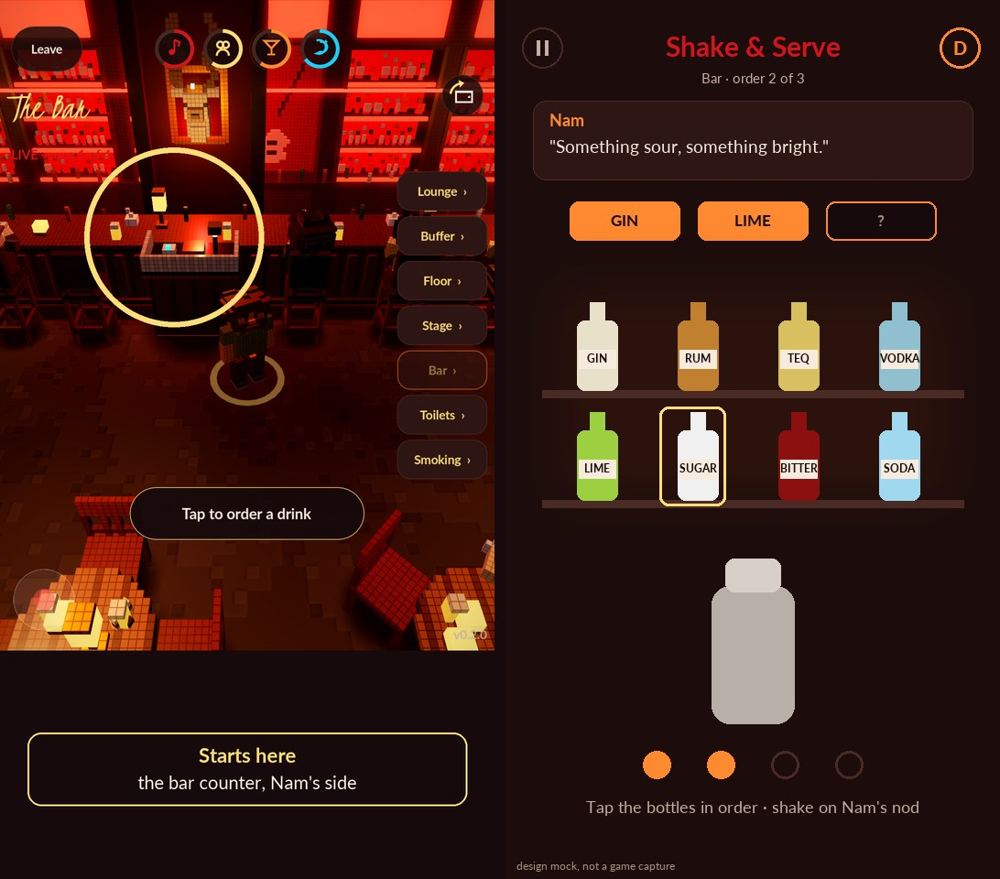
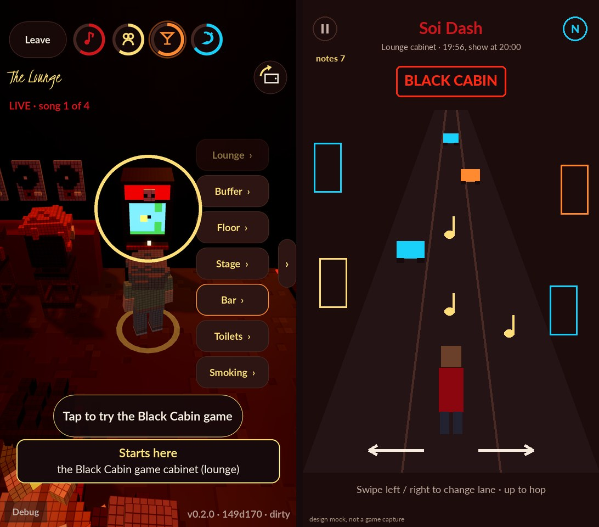

# 10 — The next minigame (BACKLOG B3): three concepts, one pick

**Update 2026-11-15, build round:** Daniele: "buiuld them all why not" (DECISIONS 2026-11-15), plus "also the
flappy birds game like for the cabinet" (owner item 35): concept **D. Neon Moth** below, an original one-tap flyer.
Build order A → D → C → B; each lands on its own review card. Numbers as built are in each section ("As built").

Design only, 2026-11-15 (🎲 design-minigame, 0.3.0 round; load id 2026-11-15-rules-powers-black-cabin-c33dc1).
**Nothing here is built or decided.** Rules, balance and money are Daniele's call: he picks one on the hub card
`minigame-next-pick` (https://claude.ai/artifact/BbpBxVWVVXMjz7TgJ7aFBW#questions), then a build round follows.
Pictures: `docs/art/screens/minigame-next/` (each concept = an annotated venue capture of where it starts + a
design mock of the play screen in the style-guide palette; the mocks are drawings, not game captures).

## What every concept must fit (from the binding docs)

- **One thumb, portrait, 30–90 s** (GDD §9; DECISIONS 2026-10-27).
- **Feeds a need of the four-meter loop** through one entry in `Rules.ACTIONS` (score-scaled `[min, max]`).
- **Sits on `minigame_base.gd` unchanged:** a `Control` scene that sets `game_id / action_id / need_id / title_key`
  in `_init()`, runs on `advance(dt)` (so tests drive it without a clock) and calls `finish(score 0..1)`. The base
  already gives the miss tier (< 0.25, 0.4 while Rusty), good / great / perfect at 0.6 / 0.85, the result card,
  the 3-tries-per-visit count and `minigame_played` (+3 Nightlife). No engine change, no base change.
- **Coins (04-coins, signed off):** every minigame pays the same: good / great / perfect = **2 / 3 / 5**, first 4
  results per visit, then 1; a miss pays nothing; caps 60 a day, 250 a week. None of the three concepts asks
  for a new coin rule.
- **Stakes §7.2:** misses are real (no gain, no coins), 3 tries per visit, misses included.
- **Where the gaps are now:** Friends has one minigame (Candle Talk, once per regular per day) and is the
  tightest meter in the GDD sample visit (+23 against ~84 a week). Drinks has Pour Perfect plus free orders.
  Two venue zones are live but empty: the **tall tables** (zone `tall`, Buffer + main-room opening) and the
  **Black Cabin game cabinet** in the lounge, whose prompt already says "Tap to try the Black Cabin game"
  (both are "stub, generic sheet" in `venue_zones.gd`).

## The three concepts at a glance

| | A. Coaster Flip ★ rec | B. Shake & Serve | C. Soi Dash |
|---|---|---|---|
| Pitch | Flick a stack of Black Cabin coasters off the table edge and catch it; beat the regular's stack | Nam takes an order by mood; pick the bottles in order and shake on her nod | Run down the soi to Black Cabin's door before the 20:00 show, dodging bikes and carts |
| Starts at | Any **tall table** (zone `tall`; Buffer, main-room opening) | The **bar** (a row under Pour Perfect) | The **game cabinet** in the lounge (zone `cabinet`) |
| Controls | Swipe up (flip), tap (catch) | Tap bottles, tap on the beat | Swipe left / right (lane), swipe up (hop) |
| Length | 30–45 s | 45–60 s | 40 s |
| Need | **Friends +8–12** (new action) | **Drinks +20–30** (existing `pour_perfect` action) **+ Friends +5** at great+ | **Nightlife +10–20** (new action, pinball's band) |
| Coins | 2 / 3 / 5 (standard) | 2 / 3 / 5 (standard); the drink is free like Pour Perfect (**money call**) | 2 / 3 / 5 (standard) |
| Effort | **S** | **M** (+ the cocktail facts) | **M** |
| Needs from the bar | Nothing (coaster look from the photos; a real coaster photo would help) | The **cocktail page** (still pending) or a classic list | Nothing (street look is generic Bangkok, no real shop names) |
| Picture | `a-coaster-flip.jpg` | `b-shake-serve.jpg` | `c-soi-dash.jpg` |

D (added for the build round): **Neon Moth**, the game cabinet (shared with Soi Dash: the cabinet offers a pick),
one tap = one flutter, Nightlife +10–20 (new action `neon_moth`), coins 2 / 3 / 5 standard, 45 s, effort S.

## A. Coaster Flip (recommended)

**Pitch.** The bar trick everyone at a high table tries after the second drink: a stack of Black Cabin coasters
on the table edge, flick them up, catch them in one grab. Every catch adds a coaster. The regular at the table
(Tt, Dougie, Bow... whoever hosts it) has a stack to beat and a line for each try.

**Where.** Walk up to any tall table (zone `tall`). The sheet gets a row "Coaster Flip with <regular>" (or "Coaster
Flip" alone at an empty table); it replaces the generic stub sheet's only row (sit) as the first row, sit stays.

**Controls (one thumb).** Swipe up anywhere to flick the stack: the coasters tumble up in an arc, spinning. A gold
ring marks the catch point; **tap when the spinning coasters line up flat in the ring**. A good catch = stack +1,
next flip spins a little faster and wobbles a little more. A miss-catch drops the stack (coasters scatter, no
mess, no penalty beyond losing a drop). **3 drops** per round; the round ends at the third drop or at 45 s.

**Score.** `score = clamp(best_stack / 10, 0, 1)` with a small quality term for clean catches:
`score = 0.85 * best_stack/10 + 0.15 * mean_catch_quality`, clamped.
Read: stack 2 or less = **miss** (< 0.25), 3–5 good, 6–8 great, 9–10 perfect. The regular's "stack to beat" is
fixed per regular (Tt 7, Dougie 5, Bow 6 ...), shown on their card; beating it plays their own reaction line
(03-cast §3.5 voice) and, at most once a visit, counts as a received **cheers** (existing `social_verb`, +2
Friends, already capped at +10 a visit). Relaxed timing (accessibility flag) widens the catch window 50 %.

**Feeds.** New action `coaster_flip`: Friends **[8, 12]** (GDD §9 #7 numbers), **cap 20 per visit** (two good
rounds; the third try still pays coins and best score). Not daily-once, so Friends gets a second, repeatable
source next to Candle Talk without outgrowing it (Candle Talk 10–20 + lean 5 stays the big Friends gain).
Coins: standard 2 / 3 / 5. `minigame_played` +3 Nightlife as for every non-miss.

**Effect on the week.** Sample visit (GDD §2.3) with one good round: Friends +23 → +33 (of ~84 weekly decay):
three visits now cover Friends with room to spare instead of exactly. Daniele's call whether that's welcome.

**As built (2026-11-15).** `score = min(best run, 10) / 10 × (0.85 + 0.15 × mean catch quality)`, where quality
is how flat the coasters were at the tap. Best run 2 or less = miss; 3–6 good; 7–9 great; 10 perfect (9 with
clean catches also reaches perfect). A run of 10 ends the round. The flat window narrows with each catch
(|cos spin| ≥ 0.75 + 0.02 per catch, max 0.95; relaxed timing −0.15) and the spin speeds up (1.2 + 0.12 turns/s
per catch). Stacks to beat: Tt 7, Dougie 5, Bow 6, Tong 4, Ploy 6, Jules 8, Lung Nop 3, Hiro 9, the house 6.
Beating it shows "You beat <name>!" and is in the result; the +2 cheers bonus was left out (it would have
needed a hook outside the game; easy to add at acceptance). Friends [8, 12], cap 20 a visit, as designed.

**Build (S).** One scene `coaster_flip.gd` on the base (draw code like `pour_perfect.gd`: one stack, one arc,
one ring), one `ACTIONS` row, one sheet row for zone kind `tall` in `venue_session.gd`, strings (EN + TH
drafts), `test_minigames` cases (miss / good / perfect driven through `advance`). No venue or layout change.

**Open for Daniele.** (1) Friends [8, 12] with cap 20 a visit, or daily-once per table like `sit_with`?
(2) "stack to beat" per regular as listed, or the player's own best only?

## B. Shake & Serve

**Pitch.** GDD §9 #2: a regular (or Nam) orders by mood ("something sour, something bright"); tap the bottles
from the backlit shelf in the right order, then shake on a four-beat count cued by Nam's nods, and serve.
Three orders per round; recipes you got right go in a recipe book.

**Where.** The bar, a new row under Pour Perfect: "Shake & Serve · <regular>'s order".

**Controls.** Tap bottles (8 on two shelves, big targets); then tap anywhere on each of 4 beats.

**Score.** Per order: recipe correct in order = 0.6 (each wrong bottle −0.2), shake = 0.4 × beat accuracy. Round
score = mean of the 3 orders. The recipe shows for 2 s, then hides (a "great" needs memory, not reading).

**Feeds.** The existing `pour_perfect` action already reads "Pour Perfect / Shake & Serve" in `rules.gd`: Drinks
**[20, 30]**; plus a new bonus `shake_serve_friends` Friends **+5** at great or better (GDD numbers). It **serves a
drink**: counts for tipsiness and "try a drink you've never had". To keep Drinks from doubling, Pour Perfect and
Shake & Serve **share the bar's 3 tries** per visit. Coins standard; the drink itself free like Pour Perfect
(**money call**: 04-coins says "Pour Perfect: free, always"; this would extend it).

**Build (M).** Scene + recipe data + recipe book screen (new UI) + shared try counter (a small change in the
venue session, not the base). **Blocked on facts:** the real cocktail page is still pending (STATE "Facts
pending"); without it the recipes would be invented, which is the bar's call. Fallback: six public classics
(Negroni, Margarita, Mojito, Daiquiri, Old Fashioned, Gin Sour) labelled as such.

**Why not first.** Drinks is the best-served meter already; it waits on bar facts; it is M with a new screen.
It is the strongest showcase of the real bar once the cocktail page arrives: a good 0.3.x follow-up.

## C. Soi Dash

**Pitch.** The Black Cabin game on the lounge cabinet: you are late for the 20:00 show; run down a neon soi
towards the Black Cabin sign, switch lanes round motorbikes and food carts, grab the music notes floating in
the street. Arrive before the clock hits 20:00.

**Where.** The game cabinet in the lounge (zone `cabinet`), whose prompt already reads "Tap to try the Black
Cabin game". Fills a visible stub in the live build.

**Controls.** Swipe left / right to change lane (3 lanes), swipe up to hop a kerb or a sleeping soi dog. A bump
never ends the run: it costs 2 s of the clock (so no fail-state frustration, the clock does the work).

**Score.** 40 s of street, fixed seed per night (same street for everyone that night, a new one tomorrow).
`score = 0.6 × notes / notes_total + 0.4 × time_left_at_door / 10 s`, clamped; arriving after 20:00 caps the
score at 0.5. Miss < 0.25 = arrived late with almost no notes.

**Feeds.** New action `soi_dash`: Nightlife **[10, 20]** (pinball's band). Coins standard.

**Build (M).** Scene with a scrolling three-lane road (2D draw, like the others), obstacle spawner on a seeded
RNG, the night seed from the Bangkok date. No venue change. Risk: two Nightlife cabinets in the same lounge and
the genre is a familiar one (lane runner); the theme (soi at night, the Black Cabin sign, the 20:00 show) keeps
it ours, no borrowed look.

**Why not first.** Nightlife already has pinball next door plus dancing and lounge entry; the Friends gap is the
bigger one; M effort for less need.

## D. Neon Moth (added 2026-11-15, owner item 35)

**Pitch.** A moth that lives in the lounge has seen the BLACK CABIN neon at the end of the room and wants it.
Tap to flutter up, let go to sink; slip through the gaps between the hanging bulb strings above and the speaker
stacks below; reach the sign. A one-tap flyer in that genre, but ours: no bird, no pipes, nothing taken from any
existing game's name, art or sound. The look is the venue's: dark red room, warm Edison bulbs, amp cabinets, the
red neon sign at the end.

**Where.** The game cabinet in the lounge (zone `cabinet`). The cabinet sheet becomes a pick of its games:
"Neon Moth" and, once built, "Soi Dash", each with its own best and its own 3 tries.

**Controls.** One tap anywhere = one flutter (an upward kick); gravity does the rest.

**Rules.** A fixed 45 s flight with **15 gates**, then the sign. Bumping a bulb string, a speaker or the floor or
ceiling singes a wing: the moth blinks for 1.2 s (no second bump in that time) and is put back in the middle of
the lane. **3 singes and the flight ends.** Same gap heights for everyone each night (seed from the Bangkok date).

**Score.** `score = 0.9 × gates passed / 15 + 0.1 if the moth reaches the sign`. Read: 3 gates or fewer =
miss (< 0.25); 4–9 good; 10–13 great; 14–15 perfect only with the sign (14 + sign = 0.94).

**Feeds.** New action `neon_moth`: Nightlife **[10, 20]**, pinball's band, no cap (like pinball). Coins: standard
2 / 3 / 5 (04-coins), first 4 results per visit, then 1. Balance knob for Daniele: three Nightlife games now live
in the lounge (pinball, Neon Moth, Soi Dash), each 3 tries; the needs' diminishing returns (GDD §2.4) flatten the
stacking, and a shared cabinet cap is a one-line change if he wants it.

**Build (S).** One scene `neon_moth.gd` on the base, one `ACTIONS` row, the cabinet sheet rows, strings, suite
`test_neon_moth`.

## Recommendation

**A. Coaster Flip.** Smallest build (S), fills the tightest meter (Friends) with a repeatable source, puts content
on the tall tables that are empty today, adds a gesture the four games don't have (swipe), and needs nothing from
the bar. Shake & Serve is the natural next one once the cocktail page arrives.

## Files

- This doc: `docs/design/10-minigame-next.md`
- Pictures: `docs/art/screens/minigame-next/` (`a-coaster-flip.jpg`, `b-shake-serve.jpg`, `c-soi-dash.jpg`,
  the three `*-mock.png`, `overview-three-concepts.jpg`)
- Contract: `game/scripts/minigames/minigame_base.gd`; actions: `game/scripts/rules.gd` (`ACTIONS`);
  stubs: `game/scripts/zones/venue_zones.gd` (`tall`, `cabinet`), rows in `game/scripts/zones/venue_session.gd`
- Binding: `docs/design/04-coins-summary.md`, `docs/design/06-stakes.md` §7.2, `docs/design/02-gdd.md` §2.3, §9
